# Solar360 – Customer & Installation Management Platform

## Project Overview

Solar360 is a Business Analysis and Software Development portfolio project designed to demonstrate how a rooftop solar company can manage its customer acquisition and installation operations through a centralized platform.

The project covers business requirements, process analysis, product planning, database design, REST API development, API testing, and management reporting.

## Business Problem

Solar installation operations may rely on spreadsheets and disconnected processes to manage customer enquiries, sales follow-ups, site inspections, quotations, installations, and customer support.

This can lead to:
- Duplicate customer records.
- Missed sales follow-ups.
- Delays in site inspections.
- Limited quotation visibility.
- Difficulty tracking installation progress.
- Fragmented customer support information.
- Lack of consolidated management reporting.

## Project Objectives

- Centralize customer and lead information.
- Improve lead follow-up visibility.
- Track site inspections and quotations.
- Monitor installation progress.
- Maintain customer support records.
- Provide management with operational KPIs and reports.

## Key Business Modules

1. Customer Management
2. Lead Management
3. Site Inspection Management
4. Quotation Management
5. Installation Management
6. Support Ticket Management
7. Product Feedback Management
8. Management Reporting

## End-to-End Business Workflow

Enquiry → Customer Registration → Lead Management → Follow-up → Site Inspection → Quotation → Installation → Customer Support → Feedback and Reporting

## Project Type

Fictional portfolio case study using synthetic data. This project is not a production deployment.

## Business Analysis Deliverables

### Requirements Analysis
- Business Requirements Document (BRD)
- Stakeholder Requirements Register
- Business Rules Register
- Functional Requirements Document (FRD)
- Requirements Traceability Matrix (RTM)

### Product Analysis
- Product Requirements Document (PRD)
- User Stories with acceptance criteria
- Product Backlog
- Sprint Planning
- Use Case Specification
- Solution Specification (planned)

### Process Analysis
- As-Is Process Flow
- To-Be Process Flow
- Business Workflow Analysis

### Agile Project Management
Project tasks were organized in Jira across four planned sprints.

| Sprint | Tasks | Story Points |
|---|---:|---:|
| Sprint 1 | 6 | 21 |
| Sprint 2 | 6 | 24 |
| Sprint 3 | 7 | 27 |
| Sprint 4 | 6 | 26 |
| Total | 25 | 98 |

### Testing and Validation
- API Test Execution Report
- Live Integration Test Report
- Defect Register
- User Acceptance Testing (UAT) Report
- API-to-Dashboard Integration Validation


## Technology Stack

| Category | Tools |
|---|---|
| Business Analysis | BRD, FRD, PRD, RTM, Use Cases |
| Agile Project Management | Jira, Scrum, Sprint Planning |
| Database | MySQL 8.0 |
| Backend API | Python, FastAPI |
| API Documentation | Swagger / OpenAPI |
| API Testing | Swagger UI |
| Data Analysis | Python, Pandas |
| Dashboard | Streamlit |
| Data Visualization | Plotly |
| Development Environment | Visual Studio Code |
| Version Control | Git and GitHub |


## System Architecture

Business Analysis → Requirements & Design → Jira Planning → FastAPI Backend → MySQL Database → Streamlit Dashboard → Management Insights

### Implemented API Modules

| API Module | Operations |
|---|---|
| Customer Management | Create, Read, Update |
| Lead Management | Create, Read, Update |

### Reporting Layer

The Streamlit dashboard retrieves MySQL data and presents executive KPIs, lead performance, inspection analysis, quotation analysis, installation performance, support tickets, feedback and management insights.

### Data Integration

Customer and lead records created or updated through FastAPI are stored in MySQL. Streamlit retrieves the latest database records when refreshed.


## Project Folder Structure

```text
Solar360/
|-- 01_Business_Analysis/
|-- 02_Datasets/
|-- 03_Documentation/
|   |-- Product_Requirements/
|-- 04_Database/
|-- 05_API_Testing/
|-- 06_Product_Testing_UAT/
|-- 07_PowerBI/ (legacy folder)
|-- 08_Release_Management/
|-- 09_Python/
|   |-- api/
|   |-- dashboard/
|-- 10_Diagrams/
|-- .gitignore
|-- README.md
```

Note: The reporting dashboard uses Streamlit. The 07_PowerBI folder is a legacy folder name.

## Implemented Prototype Features

### Customer Management
- Create customer records through the Customer API.
- Retrieve all customers and individual customer details.
- Update existing customer information.

### Lead Management
- Create new leads linked to customer records.
- Retrieve all leads and individual lead details.
- Update lead source, status, and follow-up date.
- Validate customer and sales executive references.

### Management Dashboard
- Executive overview with key business metrics.
- Lead performance and status analysis.
- Site inspection and quotation analysis.
- Installation performance monitoring.
- Customer support and product feedback overview.
- Management insights using interactive charts.

### Integration
- FastAPI connects customer and lead operations to MySQL.
- Streamlit retrieves data from MySQL for reporting.
- Dashboard metrics reflect API changes after refresh.

## API Documentation

Base URL (Local): `http://127.0.0.1:8000`

API Documentation (Local): `http://127.0.0.1:8000/docs`

Note: These URLs are accessible only when the FastAPI backend is running locally. Public deployment is planned.

### Customer API
| Method | Endpoint | Purpose |
|---|---|---|
| POST | /api/v1/customers | Create a customer |
| GET | /api/v1/customers | Retrieve all customers |
| GET | /api/v1/customers/{customer_id} | Retrieve a customer by ID |
| PUT | /api/v1/customers/{customer_id} | Update customer details |

### Lead API
| Method | Endpoint | Purpose |
|---|---|---|
| POST | /api/v1/leads | Create a lead |
| GET | /api/v1/leads | Retrieve all leads |
| GET | /api/v1/leads/{lead_id} | Retrieve a lead by ID |
| PUT | /api/v1/leads/{lead_id} | Update lead details |

## How to Run the Prototype

### 1. Start the FastAPI Backend
Open PowerShell and run:
```powershell
cd "C:\Users\user\Solar360\09_Python\api"
& ".\.venv\Scripts\python.exe" -m uvicorn main:app --reload
```

Open the API documentation:
http://127.0.0.1:8000/docs

### 2. Start the Streamlit Dashboard
Open a separate PowerShell terminal and run:
```powershell
& "C:\Users\user\Solar360\09_Python\api\.venv\Scripts\python.exe" -m streamlit run "C:\Users\user\Solar360\09_Python\dashboard\app.py"
```

Dashboard URL (Local): `http://localhost:8501`

Note: This URL is accessible only when the Streamlit dashboard is running locally. Public deployment is planned.

Prerequisites: Python, MySQL Server, project dependencies, and a configured local .env file.
Do not commit database credentials or the .env file to GitHub.

## Project Status

### Completed
- Business requirements and product documentation.
- Stakeholder requirements, business rules, and traceability matrix.
- User stories, product backlog, and four-sprint planning.
- MySQL database and synthetic sample data.
- FastAPI Customer and Lead modules.
- Streamlit management dashboard.
- API testing and live integration validation.
- UAT documentation and defect register.

### Pending
- Complete remaining UAT scenarios.
- Obtain UAT sign-off.
- Complete release documentation and deployment planning.

Project status: Working portfolio prototype – ongoing.

## Business Process Diagrams

### As-Is Process
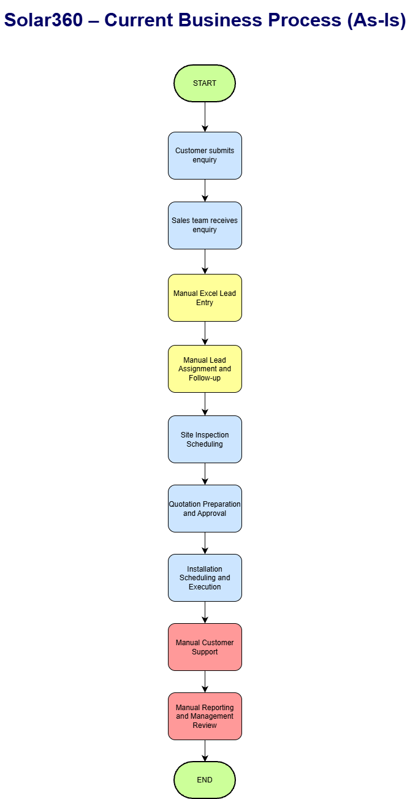

### To-Be Process
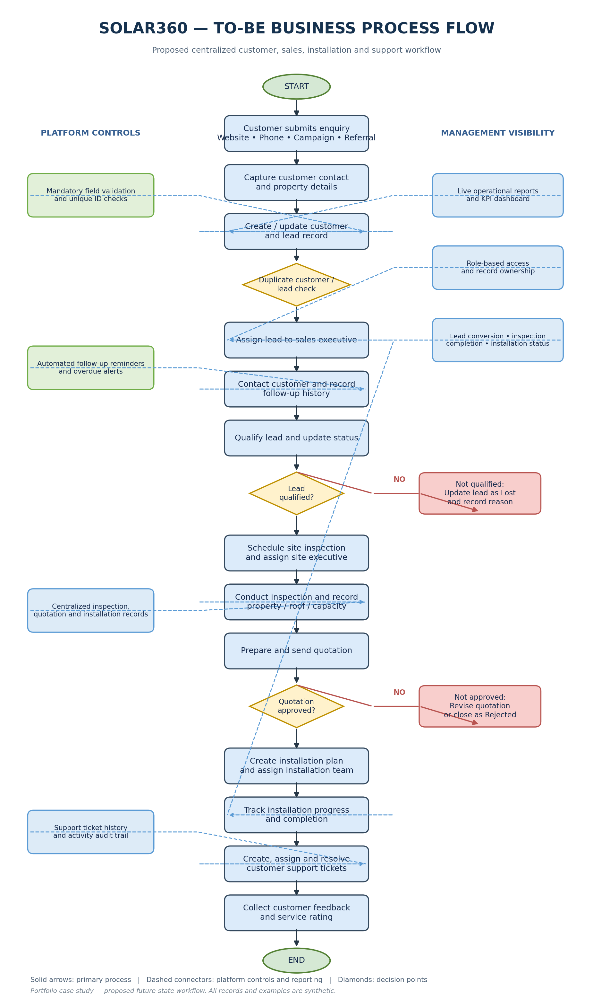

## Dashboard Visualizations

The following charts are generated from the Solar360 synthetic MySQL datasets using Python and Plotly.

### 1. Lead Performance

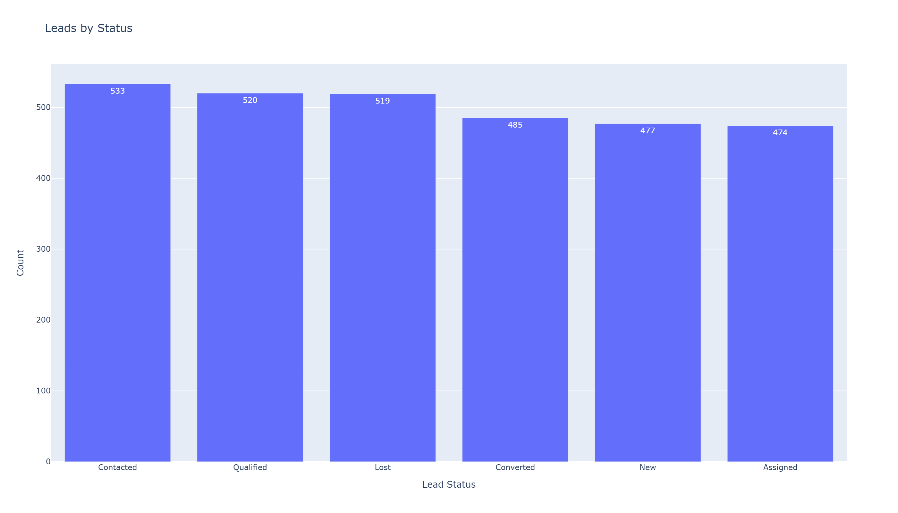

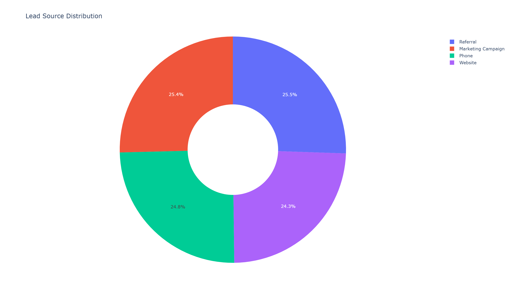

### 2. Site Inspection Analysis

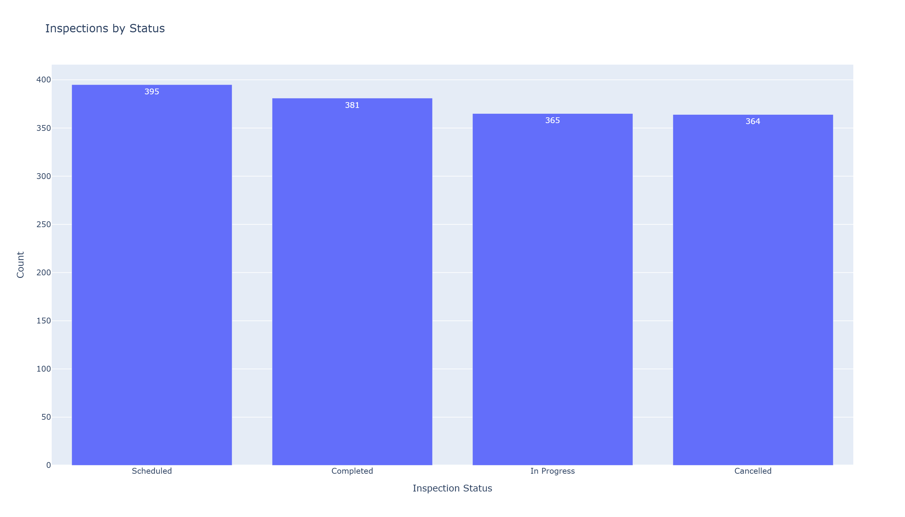

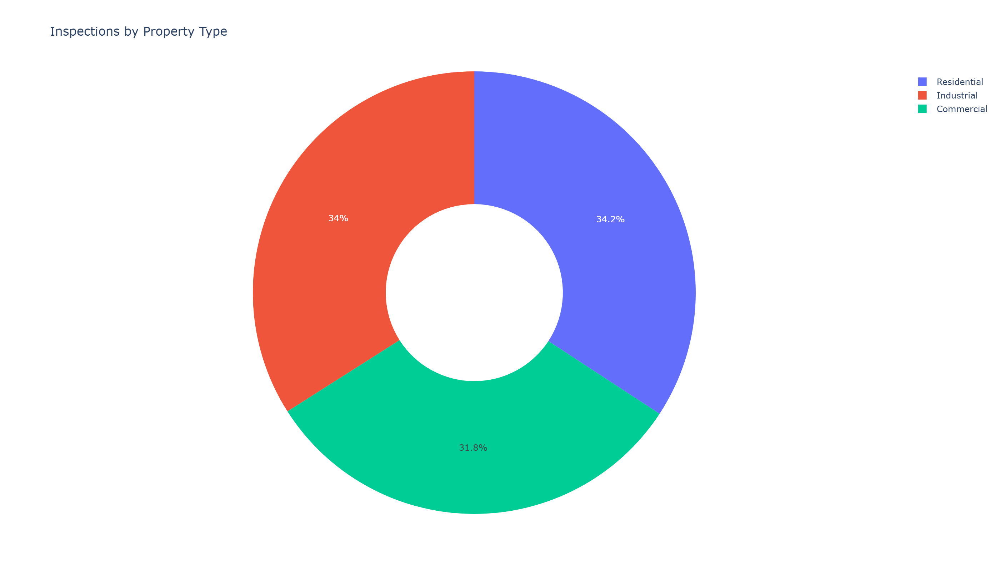

### 3. Quotation Analysis

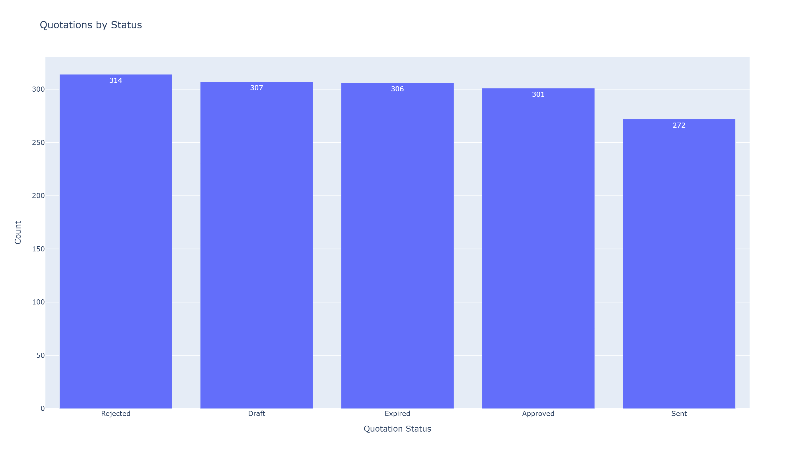

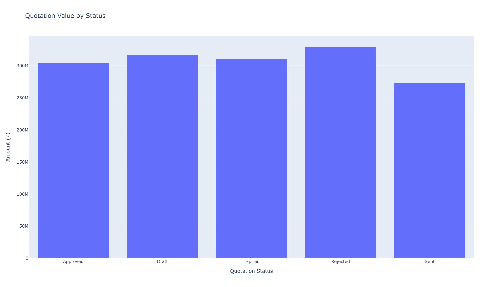

### 4. Installation Performance

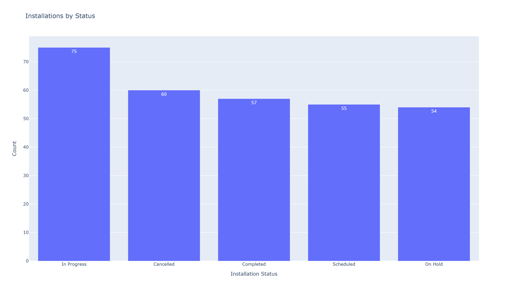

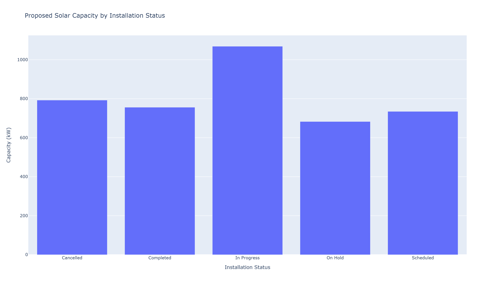

### 5. Customer Support and Feedback

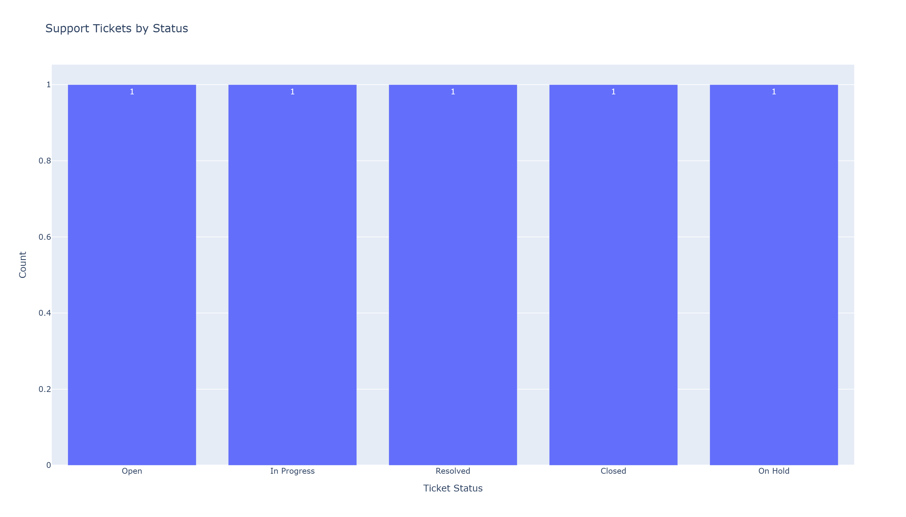

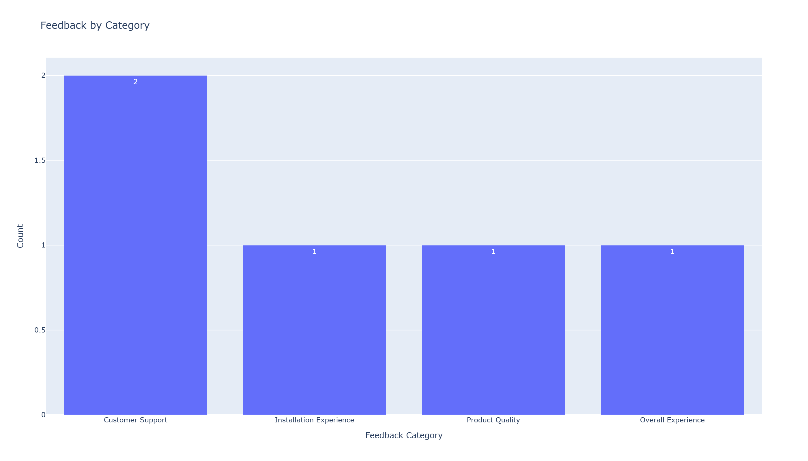

## System Architecture Diagram

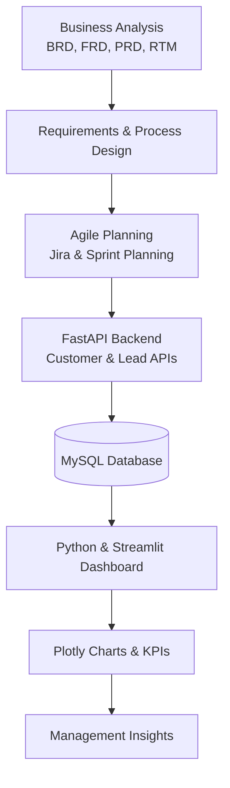

Note: Customer and Lead APIs are implemented. The dashboard reads the available business datasets directly from MySQL.

